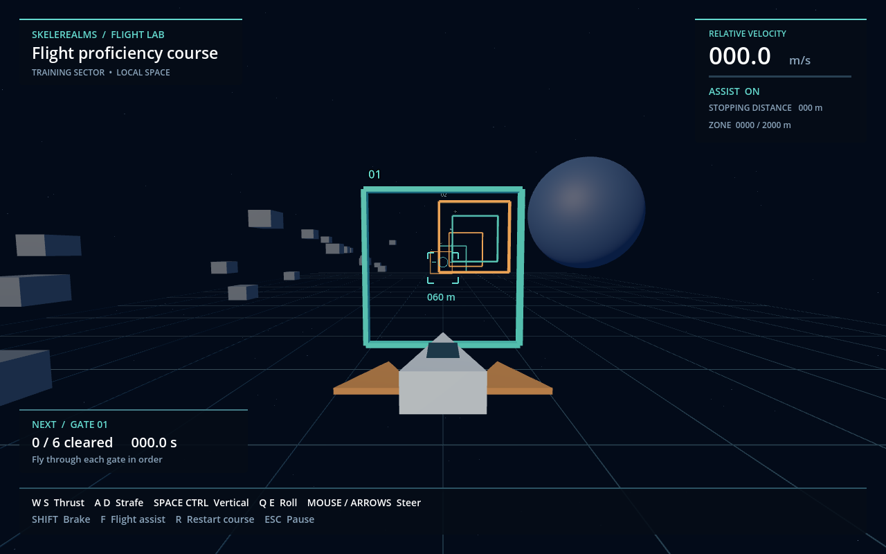

# Flight Lab

A standalone Godot **4.4.1** flight sandbox. Open `project.godot` in Godot and press **F6** on `main.tscn`, or **F5** to run the project. It has no plugin or art dependencies.

In this prepared workspace, you can also run `./tools/run_flight.ps1` from the repository root. It uses the locally downloaded engine, or accepts `-GodotPath` for another installation.



Fly the six gates in order. The HUD marks the next gate, shows its distance, and points toward it when it leaves view. Course timing starts when you move and stops after the last gate. Use the obstacles and reference grid to judge acceleration, drift, braking, and roll. The ship and its wings have physical collisions; this remains a handling prototype without combat or trading.

| Control | Action |
| --- | --- |
| W / S | Forward / reverse thrust |
| A / D | Strafe left / right |
| Space / Ctrl | Vertical thrust up / down |
| Mouse or arrow keys | Pitch / yaw |
| Q / E | Roll left / right |
| Shift | Brake; overrides held thrust |
| F | Toggle linear flight assistance; off preserves drift |
| R | Restart course; reset pose and both velocities |
| Escape | Pause / resume and release / capture mouse |

Angular stabilization stays active in both assistance modes, with inertia-compensated pitch/yaw/roll response. Mouse motion commands a turn rate that returns to center when the mouse stops. The HUD shows speed, assistance, estimated stopping distance, and distance from the origin. Switching away automatically pauses the game; use the pause menu or Escape to resume. That menu also supports restarting and exiting.

Crossing the 2 km zone boundary resets the ship and course. It is a compact test area, not an infinite flight model. Window resizing is supported down to 960×600.

`ship_controller.gd` exposes acceleration, turn rate, response, speed, and boundary settings. Its command interface also accepts AI or test input independently of the keyboard. The physics body is independent of the framework's character puppet lifecycle; a persistent ship/entity adapter is future work.

Run the real-physics checks from the repository root:

```powershell
godot --headless --path flight_sandbox -s res://test_flight.gd
```

The 30 checks cover translation and rotation axes, coasting, braking with thrust held, assistance, reset, pause, collision, speed limiting, boundary recovery, swept gate crossings, course timing, focus loss, and pause-menu restart. This is automated correctness validation; flight feel still needs playtesting.
